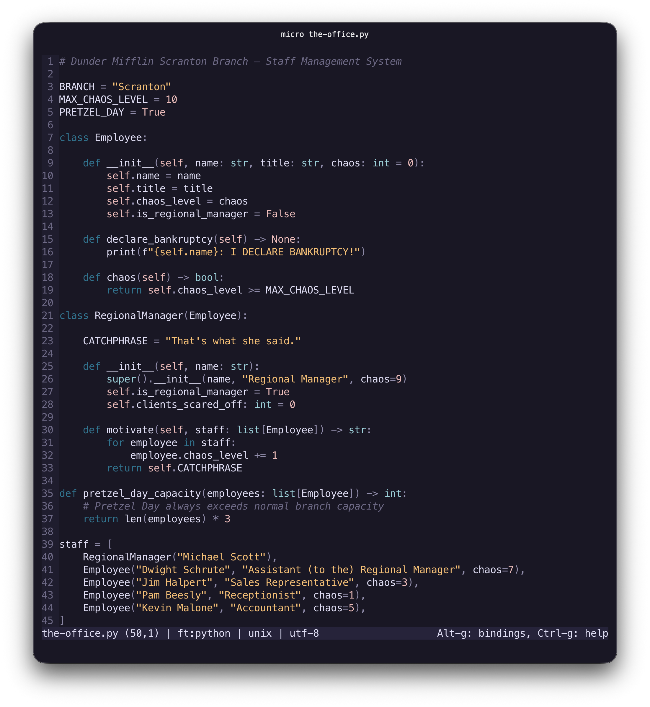
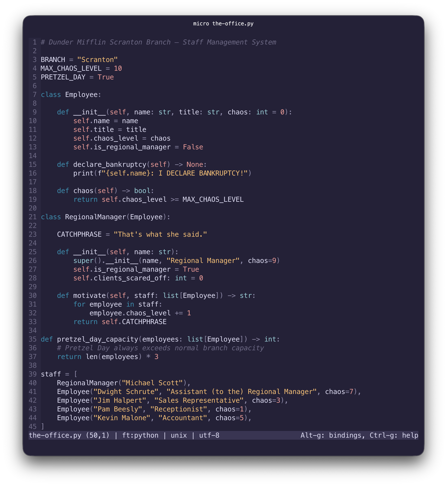
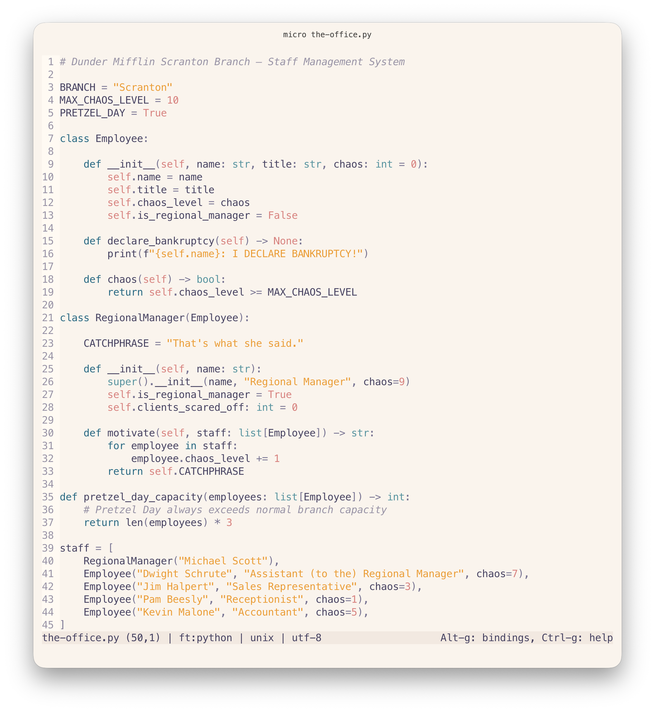

<p align="center">
    
    <h2 align="center">Rosé Pine for micro</h2>
</p>

<p align="center">All natural pine, faux fur and a bit of soho vibes for the classy minimalist</p>

<p align="center">
    <a href="https://github.com/rose-pine/rose-pine-theme">
        
    </a>
</p>

## Gallery

### Rosé Pine



### Rosé Pine Moon



### Rosé Pine Dawn



Screenshots use [Meslo LGS Nerd Font Mono](https://github.com/ryanoasis/nerd-fonts/tree/master/patched-fonts/Meslo).

<details>
<summary>Sample code used in screenshots</summary>

```python
# Dunder Mifflin Scranton Branch — Staff Management System

BRANCH = "Scranton"
MAX_CHAOS_LEVEL = 10
PRETZEL_DAY = True

class Employee:

    def __init__(self, name: str, title: str, chaos: int = 0):
        self.name = name
        self.title = title
        self.chaos_level = chaos
        self.is_regional_manager = False

    def declare_bankruptcy(self) -> None:
        print(f"{self.name}: I DECLARE BANKRUPTCY!")

    def chaos(self) -> bool:
        return self.chaos_level >= MAX_CHAOS_LEVEL

class RegionalManager(Employee):

    CATCHPHRASE = "That's what she said."

    def __init__(self, name: str):
        super().__init__(name, "Regional Manager", chaos=9)
        self.is_regional_manager = True
        self.clients_scared_off: int = 0

    def motivate(self, staff: list[Employee]) -> str:
        for employee in staff:
            employee.chaos_level += 1
        return self.CATCHPHRASE

def pretzel_day_capacity(employees: list[Employee]) -> int:
    # Pretzel Day always exceeds normal branch capacity
    return len(employees) * 3

staff = [
    RegionalManager("Michael Scott"),
    Employee("Dwight Schrute", "Assistant (to the) Regional Manager", chaos=7),
    Employee("Jim Halpert", "Sales Representative", chaos=3),
    Employee("Pam Beesly", "Receptionist", chaos=1),
    Employee("Kevin Malone", "Accountant", chaos=5),
]

if PRETZEL_DAY:
    capacity = pretzel_day_capacity(staff)
    print(f"Scranton capacity today: {capacity}")
```

</details>

## Installation

### Via Terminal

```bash
git clone --depth=1 --no-tags https://github.com/vasylromanets/rose-pine-micro /tmp/rose-pine-micro
mkdir -p ~/.config/micro/colorschemes
cp /tmp/rose-pine-micro/dist/*.micro ~/.config/micro/colorschemes/
rm -rf /tmp/rose-pine-micro
```

### Manually

1. Download the `.micro` files from the [`dist/`](./dist) folder.
2. Copy them into `~/.config/micro/colorschemes` (create the folder if it doesn't exist yet).

## Usage

Open micro's command prompt with `Ctrl-e` and run:

```
set colorscheme rose-pine
```

This updates `~/.config/micro/settings.json`. You can also edit the file directly instead:

```json
{
    "colorscheme": "rose-pine"
}
```

Available names: `rose-pine`, `rose-pine-moon`, `rose-pine-dawn`.

## Tips

### True color

These colorschemes rely on full 24-bit color. Most modern terminals support this already, but if the colors look off, make sure `COLORTERM` is set to `truecolor` in your shell, or force it in micro's settings:

```json
{
    "truecolor": "on"
}
```

## Contributing

<!-- BLOOM_BUILD_START -->
This theme was built using [bloom](https://github.com/rose-pine/rose-pine-bloom):

```sh
bloom build template.micro --output dist --prefix $ --format hex
```
<!-- BLOOM_BUILD_END -->
